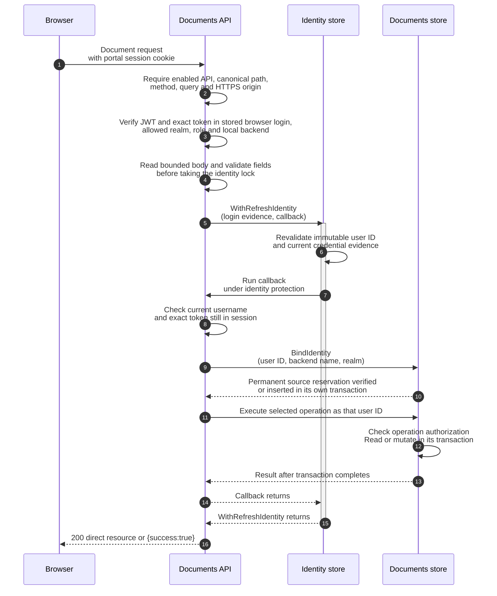
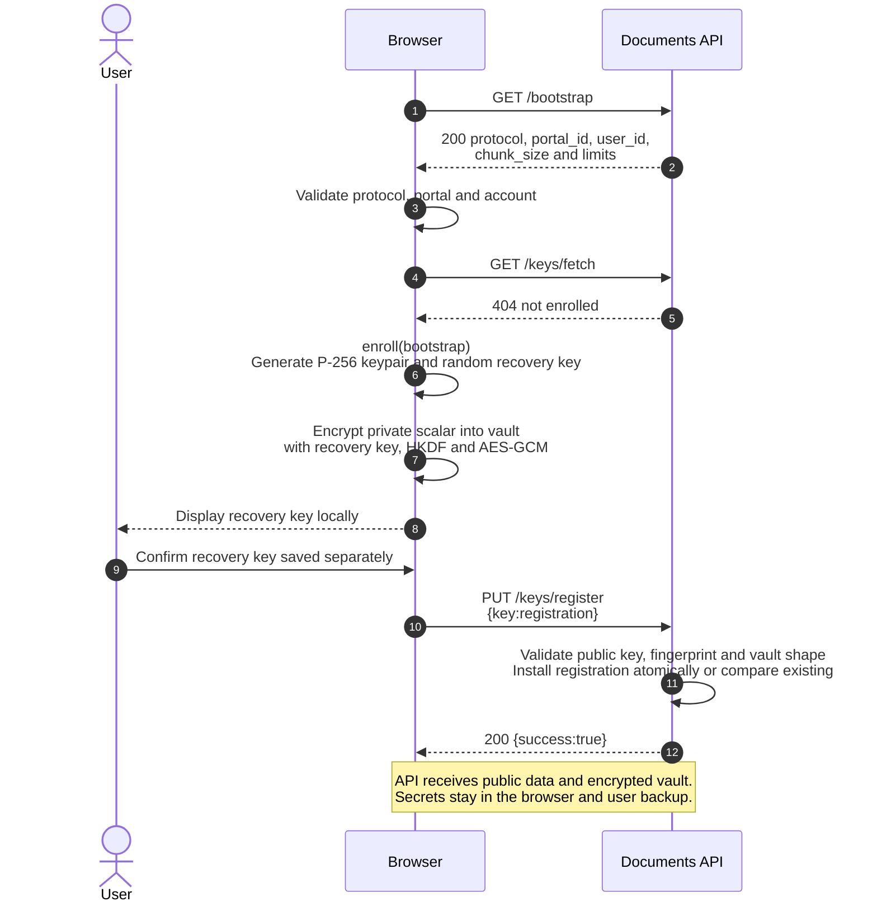
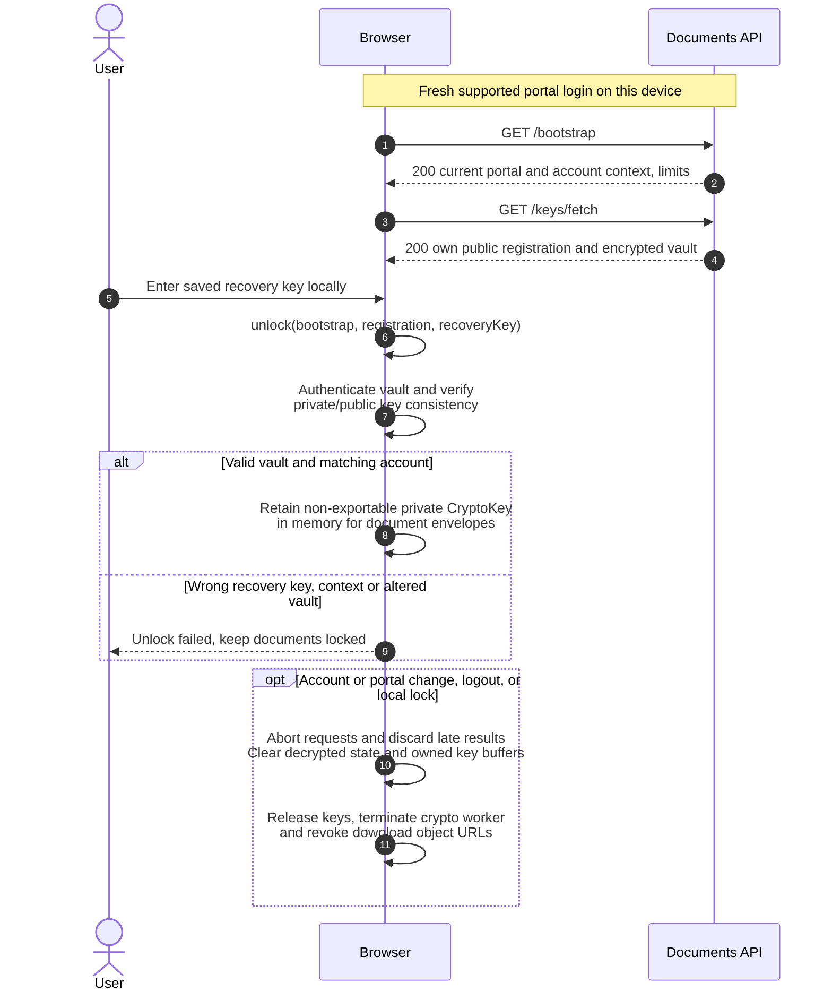
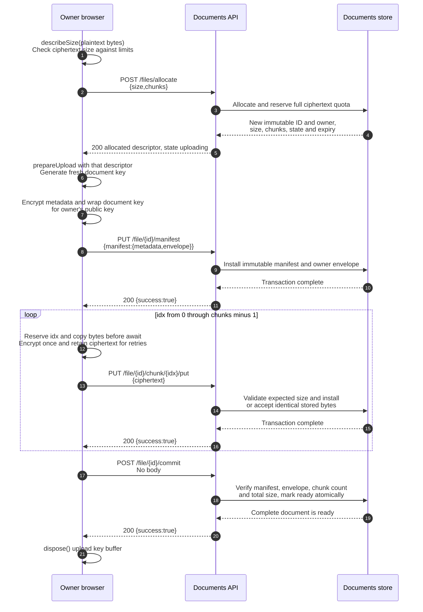
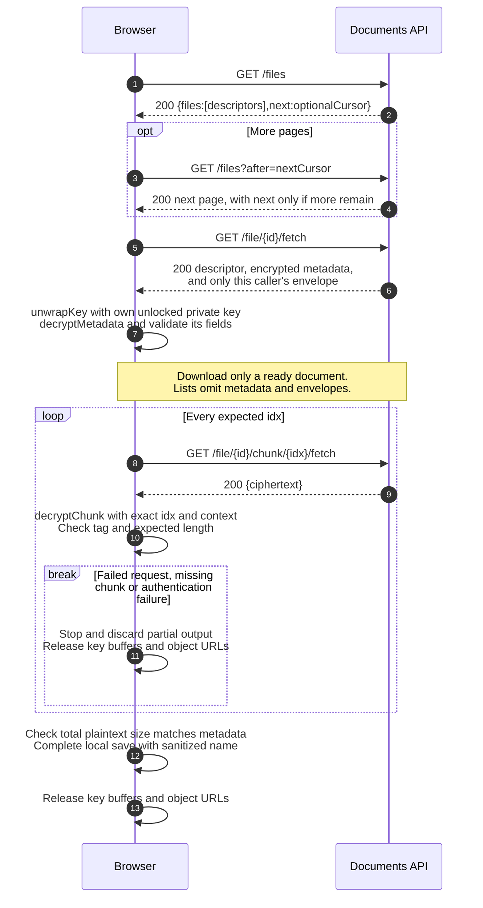
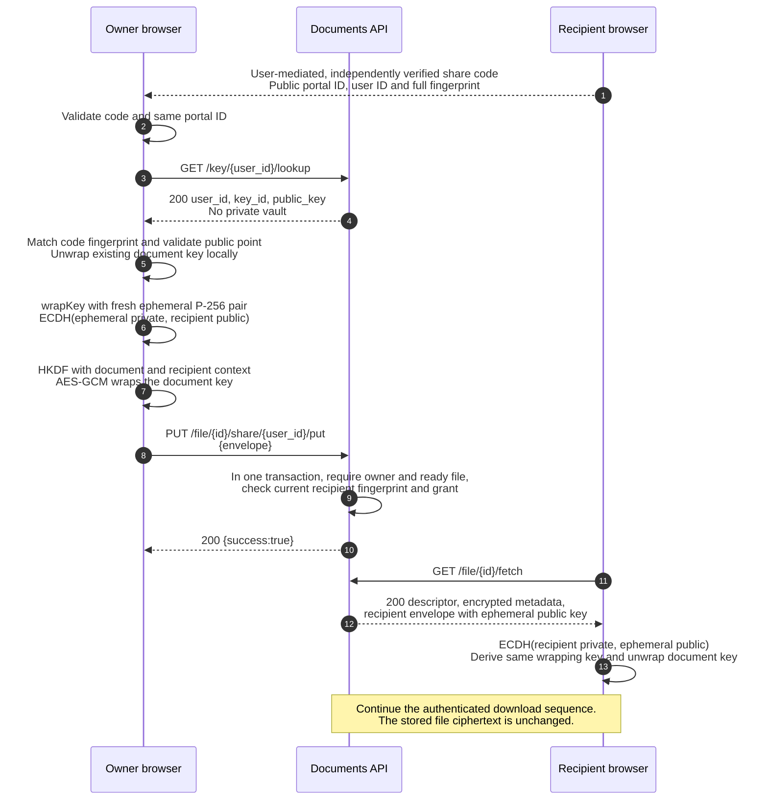
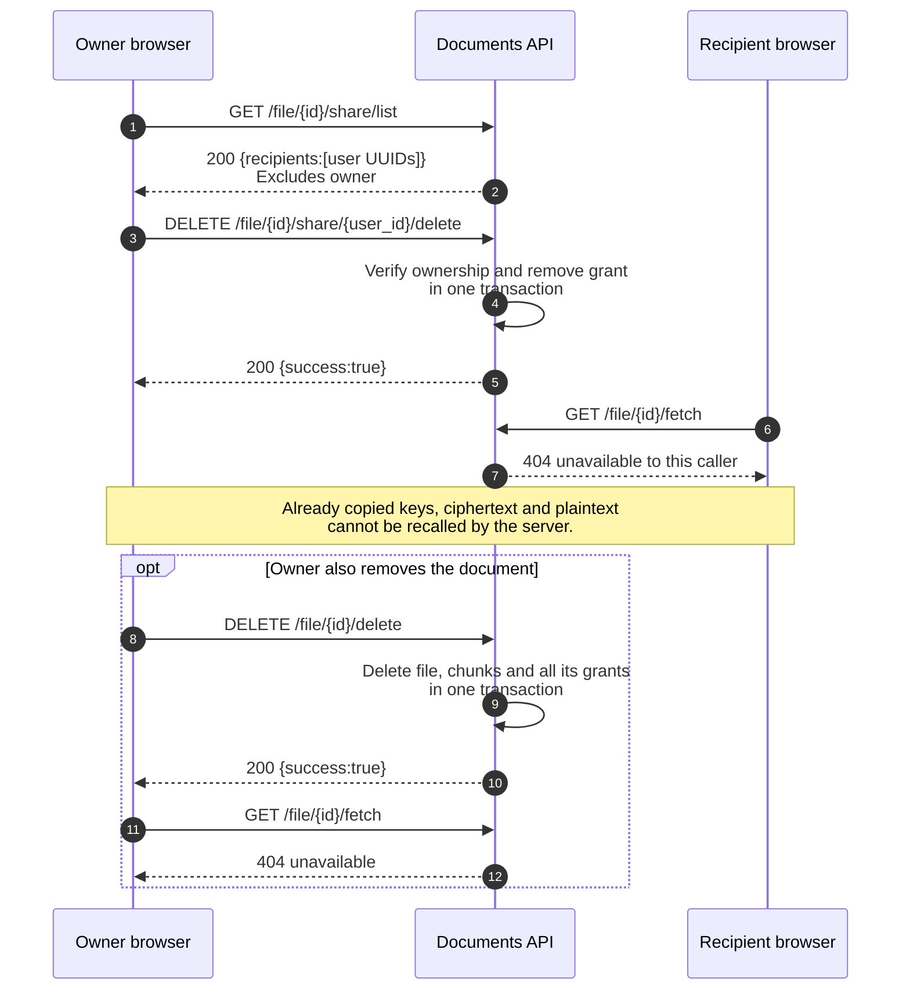
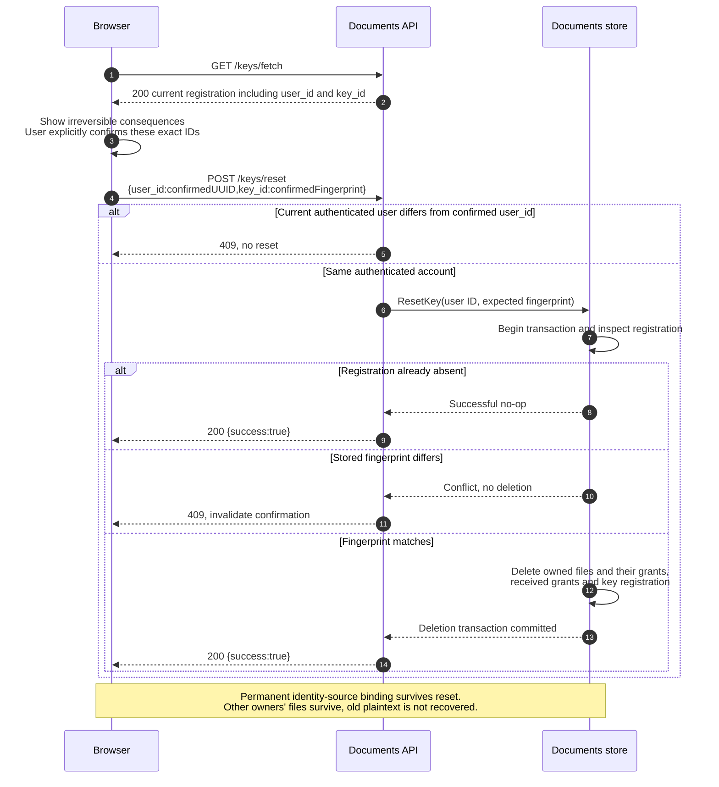

# Documents sequences and design rationale

This is the shared sequence reference for the
[backend skill](../SKILL.md) and
[React integration skill](../../documents-app-integration/SKILL.md).
Read it alongside the [cryptographic and wire contract](protocol.md) and
[OpenAPI catalogue](../../../../assets/openapi/content/openapi.yaml).
The diagrams explain the implemented API and crypto module. User confirmation,
worker isolation, safe saving and account-change cleanup are requirements for
the separately maintained React app; this repository does not contain that app.

## Reading the diagrams

All HTTP paths shown are relative to **`<portalBasePath>/api/documents`**.
For example, `GET /file/{id}/chunk/{idx}/fetch` means
`GET /auth/api/documents/file/{id}/chunk/{idx}/fetch` for a portal mounted at
`/auth`. Braces identify path parameters, not literal URL characters. `idx` is
canonical decimal without leading zeros. Account `user_id` and file `owner` are
the exact local database UUID; document IDs, portal IDs and key fingerprints
are separate 43-character base64url values.

Collection operations use `/files`, `/files/allocate`, `/keys/fetch`,
`/keys/register` and `/keys/reset`.
Operations on a specific file or recipient key retain `/file/{id}/...` and
`/key/{user_id}/lookup`. The explicit method/path selects the operation, so
neither requests nor responses repeat an operation discriminator.

Solid arrows are requests or local calls; dashed arrows are replies. Self-arrows
in a browser are local work, never API messages. Braced labels show the entire
JSON body shape with symbolic values; OpenAPI provides executable examples.
GET, DELETE and commit have no body. All successes use HTTP 200, with direct
resource fields or the literal `{"success":true}` confirmation. Descriptive
response labels abbreviate fields; consult OpenAPI for complete schemas.
No `operation`/`payload` request or `operation`/`result` response envelope exists.
Every API arrow below passes through the admission checks in the first diagram.

Read in order, or jump to
[admission](#request-admission-and-immutable-ownership),
[enrollment](#enrollment-and-the-recovery-secret),
[unlock](#unlock-on-another-device-and-session-cleanup),
[upload](#allocate-encrypt-upload-and-commit),
[download](#list-and-authenticate-a-download),
[sharing](#share-a-document-with-a-recipient),
[removal](#revoke-a-share-or-delete-a-document), or
[reset](#destructive-reset-after-key-loss).

## Request admission and immutable ownership

The successful storage path is shown; bootstrap needs the identity binding but
returns configured capabilities without a second storage operation. A failed
step stops the sequence. Disabled Documents returns 404 without provisioning a
database. A wrong method returns 405 with its method in `Allow`; stale login
evidence returns 401, and a different backend/realm claiming the same UUID gets
403. An administrator follows the same ownership checks as any other user.

**Why:** the UUID survives password changes and fresh logins, while a recreated
account gets a new UUID. Claims such as email or transformed `sub` cannot select
someone else's files. Reading the body first prevents a slow upload from holding
the account revocation lock. `BindIdentity` and the document operation have
separate SQLite transactions; the identity callback covers both, but is not a
distributed transaction. Its source reservation can remain even if the later
operation fails. A complete upload also spans many independent requests.

Initial authentication can become stale while the body arrives. The subsequent
identity/session check must reject that request without storing its chunk.
Session lookup must compare the validated token with the cached token, not just
its `jti`; replaying a previous account's token after a browser account switch
cannot borrow the new login's proof. `TestE2EDocumentsRejectsReplacedSessionToken`
covers rejection while the current login continues to work.
It also pauses a chunk upload at HTTP 100 Continue, switches the browser account,
then sends the body. The old request must fail without writing a chunk; a fresh
owner login can upload different ciphertext, commit and read it back.
The [in-flight TLS tests](../../../../pkg/authn/documents_concurrency_e2e_test.go)
hold a body after HTTP 100 Continue, complete credential revocation, then verify
both rejection and the absence of an immutable chunk left by the denied write.

See [`handleAPIDocuments` and `executeDocuments`](../../../../pkg/authn/documents_http.go),
[`Store.BindIdentity`](../../../../pkg/authn/documents/store.go), and the
[TLS authorization journeys](../../../../pkg/authn/documents_e2e_test.go).

## Enrollment and the recovery secret

Prerequisite: the operator explicitly enabled Documents, and the user completed
a supported portal browser login. An enrollment 404 is from `key.fetch` after a
successful bootstrap; a bootstrap 404 means the feature is unavailable.

**Why:** the portal login controls access to ciphertext; an independent random
256-bit recovery key controls decryption. The encrypted vault makes another
device usable without giving the server the private key. A portal password reset
cannot recover that secret. The app must wait for backup confirmation before
registration and must never send the recovery key in API calls or telemetry.

`registration` contains `user_id`, `key_id`, `public_key` and encrypted `vault`;
it does not contain the separate `recoveryKey` returned by `enroll`. Identical
registration retries succeed, but a different registration returns 409. If a
reply is lost, fetch and compare the entire stored registration before retrying;
do not generate a replacement and reset automatically.

See [`enroll` and `unlock`](../../../../pkg/authn/documents/client/crypto.mjs),
[vault derivation](protocol.md#enrollment-and-recovery-vault), and the
[independent Go interoperability test](../../../../pkg/authn/documents/protocol_test.go).

## Unlock on another device and session cleanup

**Why:** being logged in does not mean the vault is unlocked. The app must bind
its unlocked state and outstanding requests to the bootstrapped portal/user ID;
another tab can change session cookies while this tab is open. Clear stale state
before unlocking a different account, and ignore responses from the previous
account's requests. Use existing host session/refresh coordination for 401s;
never treat an unlock error as permission to reset. Worker placement and request
generation tracking belong to the React app, not to `crypto.mjs`.

The module checks the recovered private key against the registered public key
and imports it as non-exportable. Clearing buffers and dropping references is
best effort; JavaScript cannot guarantee erasure of engine-managed memory.
Password changes or portal restarts require valid new login evidence, but the
same local UUID, stored vault and saved recovery key retain access to documents.

See the [React session contract](../../documents-app-integration/SKILL.md#session-and-capability-discovery)
and [root server restart/refresh journeys](../../../../server_documents_e2e_test.go).

## Allocate, encrypt, upload and commit

Prerequisite: the owner's registration exists. Size calculations include one
16-byte GCM tag per chunk. Even an empty file has one chunk.

**Why:** allocation supplies the immutable context before any content encryption.
The module derives a different AES key for metadata and each `idx`, binding the
portal, original owner, document ID, ciphertext size and chunk count. The fixed
zero nonce is safe only with this separation and one encryption per derived key.
The client reserves `idx` before asynchronous encryption, and the server rejects
replacement ciphertext. Neither measure permits re-encryption of an accepted
chunk. The server validates structure and sizes; only clients can verify GCM.
The helper copies caller input before its first await so that clearing/reusing a
file buffer cannot silently encrypt different bytes while HKDF is pending. It
also snapshots account, descriptor and recipient context. The UI must still
discard late results on account changes: snapshotting is not cancellation, and
disposing an upload prevents new calls without cancelling work already started.

Commit provides an atomic transition to `ready`, not an atomic transaction across
the upload. Recipients cannot see unfinished files, and even the owner cannot
fetch chunk bytes before commit. Reserving the full size at allocation prevents
concurrent uploads from exceeding logical quotas. Expiry is absolute, applies to
unfinished files, and is collected during allocation rather than by a janitor.

| Interrupted step | Required continuation and reason |
| --- | --- |
| Allocation response lost | List pending entries and reconcile deliberately. Allocation is not idempotent; size/time cannot identify one tab's attempt uniquely. |
| Manifest or chunk response lost | Retry exactly the same buffered manifest/ciphertext. Identical writes succeed even after commit; different bytes return 409. |
| Commit response lost | Fetch the descriptor to check `state`; repeating commit is safe for an existing complete upload. Incomplete uploads return 409. |
| Reload loses exact upload state | Abandon/delete the known pending ID and allocate a fresh ID/key. Do not call `prepareUpload` again to resume that ID. |
| Cancel, expiry or quota failure | Keep the original local file. Delete a known pending allocation on cancel; expired uploads return 404, quota exhaustion 507. |

See [content derivation and nonce rules](protocol.md#document-content-and-metadata),
[`Store.Allocate`](../../../../pkg/authn/documents/store.go),
[`PutManifest`, `PutChunk` and `Commit`](../../../../pkg/authn/documents/transfer.go),
and the [client nonce/retry tests](../../../../pkg/authn/ui/testdata/documents_client_test.cjs).

## List and authenticate a download

Prerequisite: the caller has unlocked their own vault. The same sequence serves
the owner and an authorized recipient; `owner` always remains the original owner.

**Why:** the API lists opaque descriptors without learning filenames. Details
contain encrypted metadata and only the caller's wrapped document key. The
original owner is part of the cryptographic context even for received files;
substituting the recipient UUID would break authentication. Chunk position and
expected length are authenticated with that context, so reordered, truncated or
cross-document ciphertext must fail. Stop at the first failure, rather than
continuing the loop or exposing a partial file as a completed download.

Lists have at most 100 entries per page and can include the owner's unfinished
uploads; an unfinished entry may lack a manifest and cannot be downloaded.
Rendering decrypted names as text and saving as `application/octet-stream`
prevents uploaded HTML/SVG from becoming an executable preview. A streaming
client must clean up partial local output on failure. These save/display choices
belong to the React app and are not guarantees provided by the storage API.

See [`unwrapKey`, `decryptMetadata`, `decryptChunk`](../../../../pkg/authn/documents/client/crypto.mjs)
and the [real Chrome encryption/decryption journey](../../../../pkg/authn/ui/testdata/documents_browser_e2e.cjs).

## Share a document with a recipient

Prerequisite: both users enrolled in the same portal, the file is ready, and the
owner can unwrap its document key. The public share code contains exactly
`protocol`, `portal_id`, `user_id` and `key_id`; it is not an access token.

**Why:** ECDH lets each recipient recover the same document key using their own
private key. Only the ephemeral public key, fingerprint and encrypted document
key cross the network. The owner also has an envelope; wrapping for another
recipient neither duplicates file bytes nor transfers a private key. The API
checks authorization and envelope structure, not possession of the private key.

The context binds both document and recipient identity/fingerprint, plus the
ephemeral public key. A fresh ephemeral pair is required for every newly created
envelope. If the upload of a grant has an uncertain result, retry the saved
envelope: generating a different envelope conflicts with an existing grant.
If the recipient resets between lookup and sharing, a changed registration
returns 409 and an absent registration 404. Require a newly confirmed share code;
never silently share to a replacement fingerprint. Recipients discover granted
files through their own list and cannot grant them onward through this API.
This check happens after the request body arrives, inside the grant transaction.
A delayed envelope for an old key cannot grant access to a newly enrolled key.
Concurrent reset removes existing grants and must also prevent a racing new
grant or identical retry from leaving stale access behind.

This is not a sender-signature protocol. Independent fingerprint confirmation
reduces reliance on key discovery, but served JavaScript and endpoints remain
trusted. Standard cryptography and user-held secrets protect against passive
inspection of decrypted TLS; a secret algorithm is unnecessary. URLs, identities,
sizes, timings and sharing relationships remain observable. Durable recipient
keys do not provide forward secrecy for historical documents.

See [envelope derivation](protocol.md#recipient-envelopes),
[`Store.Share`](../../../../pkg/authn/documents/transfer.go), and
[sharing/isolation store tests](../../../../pkg/authn/documents/store_test.go).

## Revoke a share or delete a document

**Why:** authorization is checked in the same transaction as a ciphertext read,
so subsequent reads after revocation are denied. A read already authorized in a
concurrent transaction can still complete. Revocation cannot erase a recipient's
saved envelope or document key, and deletion cannot erase external copies.
Changed content must use a fresh allocation/key with envelopes only for current
recipients; editing the old ciphertext is neither supported nor safe.

Revoking an absent grant succeeds if the caller still owns an accessible file.
Deleting an already missing file returns 404. A recipient cannot delete the
owner's file or list its other recipients. Key reset is broader than either
operation and has the separate confirmation flow below.

See [`Recipients`, `Revoke`, `Delete` and `GetChunk`](../../../../pkg/authn/documents/transfer.go)
and the [TLS owner/recipient authorization tests](../../../../pkg/authn/documents_e2e_test.go).

## Destructive reset after key loss

Reset is an explicit user choice, never automatic error recovery. Show that all
owned documents, their grants, the user's received grants and the registration
will be removed. Capture the account and fingerprint displayed for confirmation.

**Why:** another tab may change cookies after the UI's check; matching the
confirmed UUID on the server prevents deleting that other account's data.
Checking the fingerprint inside the deletion transaction prevents a delayed
request from deleting a newly enrolled key. An absent registration is a no-op,
but the same request must conflict after a different registration is installed.
Do not substitute a new UUID/fingerprint or automatically reconfirm after 409.

On an uncertain response, fetch the registration and reconcile before further
action. After a confirmed reset, clear local unlocked state and start enrollment
with a fresh recovery key. Owners must share received documents again to that
new registration. Reset cannot recover lost owned documents and does not free
the permanent source reservation or permit a new backend to claim the UUID.

See [`executeDocuments`](../../../../pkg/authn/documents_http.go),
[`Store.ResetKey`](../../../../pkg/authn/documents/store.go), and the
[TLS account-switch and stale-reset tests](../../../../pkg/authn/documents_e2e_test.go).

## Keeping diagrams, implementation and tests aligned

When changing a message or lifecycle, update the relevant sequence and its
rationale with the [protocol](protocol.md), both owning skills and OpenAPI.
Check methods, path parameters, request fields, concrete responses, transaction
boundaries, retry behavior and client/server responsibility against the linked
source. Preserve unversioned paths, `fetch`, `idx` and direct JSON objects.

Render every changed Mermaid block and inspect its labels, arrows and branches;
syntax parsing alone does not establish readability. Keep diagram-rendering
artifacts in ignored `tmp/`, not in the skill or application asset tree. Then run
the skill-authoring validator and verify links. For implementation changes, use
the backend skill's acceptance commands and the owning testing/OpenAPI workflows:
store and protocol units, real TLS and browser crypto journeys, and native HTTP
schema tests establish behavior. Diagram rendering does not replace those tests.
